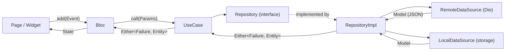
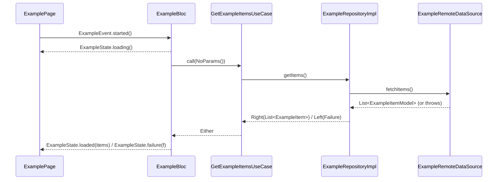
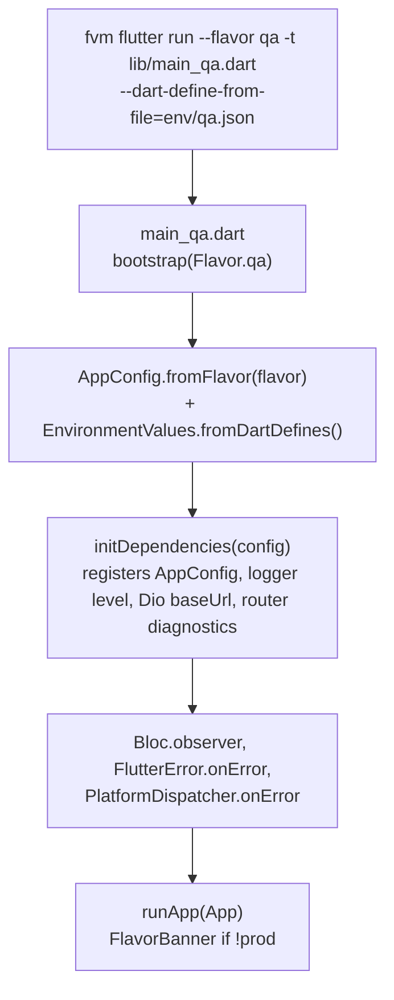

# Architecture

The app uses a feature-first Clean Architecture. Each feature is a vertical slice with three layers. Cross-cutting
code lives in `core/` (non-UI infrastructure) and `shared/` (reusable UI).

## Layers

| Layer | Contains | May import |
| --- | --- | --- |
| **domain** | Entities (freezed), repository interfaces (`abstract interface class`), use cases | Pure Dart only: `core/error`, `core/usecase`, `core/utils`, `freezed_annotation`, `fpdart`, `equatable`. **No** Flutter, Bloc, get_it, Dio or JSON. |
| **data** | Models (freezed + json, `toEntity()`), remote/local data sources (abstract + `Impl`), repository implementations | domain, `core/*`, Dio, storage |
| **presentation** | Pages, widgets, blocs/cubits | domain, `core/*`, `shared/*`, Flutter, flutter_bloc |

### Dependency rule

```
presentation ──▶ domain ◀── data
```

- Domain depends on nothing else.
- Presentation never imports from `data/`. Data never imports from `presentation/`.
- **Features never import from other features.** If two features need the same thing, move it to `core/`
  (non-UI) or `shared/` (UI). To coordinate features, use navigation (route parameters) or a shared domain
  abstraction in `core/`.
- `app/` is the composition layer (router, DI, `App`). It's the only place allowed to import from every feature.

### Import rule (enforced by the analyzer)

**Always use package imports** (`package:app_core/...`), including inside a feature. This is enforced by the
`always_use_package_imports` lint from `very_good_analysis`, so `fvm flutter analyze` fails on relative imports.
Tests may import their own helpers relatively (`../../helpers/mocks.dart`).

## Data flow





## Error handling

- Data sources throw. They may throw an `AppException` subtype (`core/error/exceptions.dart`), a `DioException` or a
  parsing error.
- **Repositories catch everything** and convert it with `ErrorMapper.toFailure(e)` into a sealed freezed
  `Failure` (`server`, `network`, `unauthorized`, `cache`, `parsing`, `unexpected`).
- Repositories and use cases return `FutureEither<T>` (`Future<Either<Failure, T>>`).
- Blocs and the UI never see raw exceptions. They switch on the `Failure` and show `failure.message`.
- Uncaught errors go through `FlutterError.onError` and `PlatformDispatcher.instance.onError` in `bootstrap.dart`.
  There's a `TODO(crash-reporting)` hook for Crashlytics or Sentry, which will be enabled for qa, staging, uat and prod
  (`Flavor.isCrashReportingEnabled`).

## Dependency injection (get_it)

- A single `GetIt sl = GetIt.instance` lives in `app/di/injection_container.dart`.
- `initDependencies(AppConfig)` registers core services first. Then it calls each feature's
  `registerXDependencies(sl)`, which lives in `features/x/x_injection.dart`, so features own their registrations.
- Always register against the abstract type: `sl.registerLazySingleton<ExampleRepository>(() => ExampleRepositoryImpl(...))`.
- `sl` is used **only** in DI files, route builders and `bootstrap.dart` (the composition root). Every class
  receives its dependencies through its constructor. Never call `sl()` inside widgets, blocs, repositories or use
  cases.
- In tests, call `resetDependencies()` (or `resetGetIt()` from `test/helpers`) in `tearDown`.

| What | Lifetime | Why |
| --- | --- | --- |
| `AppConfig` | `registerSingleton` | Built once before DI starts |
| Logger, Dio, storage, NetworkInfo, GoRouter, AuthGuard | `registerLazySingleton` | Shared, stateless or app-wide |
| Data sources, repositories, use cases | `registerLazySingleton` | Stateless |
| **Blocs / Cubits** | **`registerFactory`** | A fresh instance per route; `BlocProvider` closes it |

## Bloc conventions

### Bloc or Cubit?

- **Bloc:** event-driven or complex flows. Use it when several inputs affect the same state, you need event
  transformers (debounce, drop, restart), or you want a traceable event log. Examples: lists with
  load/refresh/paginate, search, forms with async validation, auth.
- **Cubit:** simple UI state with direct method calls and no concurrency concerns. Examples: a tab index, a toggle,
  a theme mode, a stepper.

### State shape: sealed union

States and events are **freezed sealed unions**, and we use this consistently:

```dart
@freezed
sealed class ExampleState with _$ExampleState {
  const factory initial() = ExampleInitial;
  const factory loading() = ExampleLoading;
  const factory loaded(List<ExampleItem> items) = ExampleLoaded;
  const factory failure(Failure failure) = ExampleFailure;
}
```

- The UI uses an exhaustive `switch (state)`, so the compiler flags a missing case.
- "Empty" is `loaded([])`, handled in the UI with a `when items.isEmpty` guard.
- Refresh doesn't emit `loading`, so the content stays on screen.
- If a screen really needs data and status together (e.g. pagination with an inline error), use a single freezed
  class with a `status` enum for **that** bloc, and explain why in a comment.

> **Syntax note.** Dart 3.13 with `very_good_analysis` 11 enforces the new constructor syntax
> (`unnecessary_type_name_in_constructor`): `const factory loaded(...)` instead of
> `const factory ExampleState.loaded(...)`, and `const new(...)` instead of `const MyWidget(...)`. Call sites are
> unchanged (`ExampleState.loaded(items)`, `MyWidget()`). `fvm dart fix --apply` converts old syntax automatically.

### Event concurrency (`bloc_concurrency`)

| Event kind | Transformer | Effect |
| --- | --- | --- |
| Initial fetch / retry / submit | `droppable()` | Ignores new events while one is running (no duplicate requests) |
| Search-as-you-type / refresh | `restartable()` | Cancels the running handler; only the latest result is emitted |
| Independent actions (e.g. toggle an item) | `concurrent()` (default) | Run in parallel |
| Must run in order (e.g. a queue of writes) | `sequential()` | One at a time, in order |

Register a transformer for **every** event handler, even when it's the default, so the intent is explicit.

### Rules

- Blocs depend on **use cases only**, never on repositories or data sources.
- No business logic in widgets. Widgets dispatch events and render state.
- Use `BlocBuilder` for rendering, `BlocListener` for one-off side effects (snackbars, navigation) and
  `BlocConsumer` when you need both. Use `buildWhen`/`listenWhen` to avoid needless work, and `BlocSelector` to
  rebuild a small widget from one derived value (see the item count in `ExamplePage`).
- `AppBlocObserver` logs transitions in dev and qa, and errors in every flavor.

## Navigation (go_router)

- The router is built in `app/router/app_router.dart` and registered in get_it as a lazy singleton.
- Navigate with names only, using `context.goNamed(RouteNames.x)` or `context.pushNamed(RouteNames.x,
  pathParameters: {...})`. Paths live in `RoutePaths` and are used only in `app_router.dart`.
- Each route builder scopes its bloc to the route:
  ```dart
  builder: (context, state) => BlocProvider(
    create: (_) => sl<ExampleBloc>()..add(const ExampleEvent.started()),
    child: const ExamplePage(),
  ),
  ```
- `errorBuilder` shows `NotFoundPage`. `redirect` calls `AuthGuard.redirect`, a placeholder for now. When auth
  exists, give the guard an auth repository and pass its stream to the router's `refreshListenable` (for example
  through a `ChangeNotifier` that listens to the auth bloc's stream).
- `debugLogDiagnostics` is on for dev and qa only.

### Adding bottom navigation later

Wrap the tab routes in a `StatefulShellRoute.indexedStack`. Each branch keeps its own navigation stack:

```dart
StatefulShellRoute.indexedStack(
  builder: (context, state, navigationShell) =>
      HomeShell(navigationShell: navigationShell), // Scaffold + NavigationBar
  branches: [
    StatefulShellBranch(routes: [
      GoRoute(name: RouteNames.example, path: RoutePaths.example, builder: ...),
    ]),
    StatefulShellBranch(routes: [
      GoRoute(name: RouteNames.settings, path: RoutePaths.settings, builder: ...),
    ]),
  ],
),
```

In `HomeShell`, use `navigationShell.currentIndex` for the selected tab and `navigationShell.goBranch(index)` on
tap. Put the shell widget in `app/router/` (or `shared/widgets/` if it's reused).

## Flavors and config flow



- `Flavor` (an enum in `core/config/flavor.dart`) holds the per-flavor **behaviour**: name, log level,
  `isDebugTools`, `isCrashReportingEnabled` and the banner label.
- `env/<flavor>.json` holds the per-environment **values** (URLs, keys, timeouts).
- Native side:
  - **Android:** `productFlavors` in `android/app/build.gradle.kts` (`applicationIdSuffix`, `resValue app_name`).
    Icons are in `android/app/src/<flavor>/res`.
  - **iOS:** the `dev`/`qa`/`staging`/`uat`/`prod` schemes use `Debug-<flavor>`, `Release-<flavor>` and
    `Profile-<flavor>` configurations. Each is backed by `ios/Flutter/<Mode>-<flavor>.xcconfig`, which includes
    `ios/Flutter/Flavors/<flavor>.xcconfig` (`PRODUCT_BUNDLE_IDENTIFIER`, `DISPLAY_NAME`,
    `ASSETCATALOG_COMPILER_APPICON_NAME`).
  - iOS plugins use Swift Package Manager, so there's no Podfile. If a future plugin needs CocoaPods, Flutter
    generates a Podfile. Map the custom configurations there
    (`project 'Runner', { 'Debug-dev' => :debug, 'Release-dev' => :release, 'Profile-dev' => :release, ... }`) and
    add `#include? "Pods/Target Support Files/Pods-Runner/Pods-Runner.<config>.xcconfig"` to each
    `ios/Flutter/<Mode>-<flavor>.xcconfig`.

## Naming

- Files use `snake_case.dart`.
- Class suffixes: `*Page`, `*Bloc`, `*Event`, `*State`, `*Cubit`, `*Repository` (interface), `*RepositoryImpl`,
  `*UseCase`, `*Model`, `*RemoteDataSource`/`*LocalDataSource` (interface) plus `*Impl`.
- Bloc files: `x_bloc.dart` with `part 'x_event.dart'` and `part 'x_state.dart'`.
- One feature DI file: `features/x/x_injection.dart` → `registerXDependencies(GetIt sl)`.
